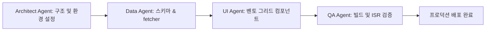

# 01. 에이전트 페르소나 및 역할 분담 (Agent Personas & Collaboration Protocol)

본 문서는 4인 팀의 실제 역량 모델과 이를 대변하여 소프트웨어를 구축하는 AI 에이전트의 페르소나, 역할 및 인수인계(Hand-off) 프로토콜을 규정합니다.

---

## 1. 4인 크리에이티브 팀 멤버 프로필 모델

스튜디오 허브에 반영되는 4인의 핵심 역량과 역할은 다음과 같습니다:

```text
+-----------------------------------------------------------------------------------+
|                           4-PERSON MULTIDISCIPLINARY TEAM                         |
+-------------------------+-------------------------+-------------------------------+
| 1. Product Designer     | 2. Frontend Engineer    | 3. Fullstack Developer        |
| - Swiss Minimalist UI/UX| - Next.js 15 App Router | - Notion API & Headless CMS   |
| - Variable Typography   | - Tailwind CSS v4       | - Edge Serverless & ISR (60s) |
| - Design Tokens & Grid  | - Responsive Bento Grid | - Type Safety (No `any`)      |
+-------------------------+-------------------------+-------------------------------+
|                                4. Growth Marketer                                 |
|                                - OneLiner Copywriting                             |
|                                - Brand Presence & Multi-brand Governance          |
|                                - Status Tracking (Active / In Dev / Concept)      |
+-----------------------------------------------------------------------------------+
```

1. **Alex Kim (Product Designer)**
   - **Role**: UI/UX, Swiss Typography, Visual Hierarchy
   - **Core Skills**: `Figma`, `Design Systems`, `Variable Fonts`, `Micro-interactions`
   - **Status**: Available
2. **Chloe Lee (Frontend Engineer)**
   - **Role**: Responsive Web, Bento Grid, Accessibility
   - **Core Skills**: `Next.js`, `TailwindCSS v4`, `TypeScript`, `Framer Motion`
   - **Status**: In Project
3. **David Park (Fullstack Developer)**
   - **Role**: Data Pipeline, Notion API Integration, Performance
   - **Core Skills**: `Node.js`, `React Server Components`, `Edge Cache`, `API Optimization`
   - **Status**: Busy
4. **Sara Choi (Growth Marketer)**
   - **Role**: Content Strategy, Multi-brand Portfolio, Analytics
   - **Core Skills**: `Growth Strategy`, `Content Design`, `Brand Storytelling`, `SEO`
   - **Status**: Available

---

## 2. AI 에이전트 4대 전문 분신 (Agent Harness Personas)

개발 과정에서 단일 에이전트가 모든 작업을 한 번에 처리하려 할 때 발생하는 컨텍스트 과부하와 환각을 방지하기 위해, 작업을 4가지 전문 에이전트 관점으로 분할합니다.

### 🏛️ 에이전트 1: Chief System Architect Agent
- **주요 임무**: 프로젝트 아키텍처 거버넌스 및 제약 조건 통제
- **핵심 역량**:
  - $0 제로 코스트 인프라(Vercel Hobby, Cloudflare Pages Free Tier) 아키텍처 수호
  - Next.js 15 App Router의 서버 컴포넌트(RSC) 원칙 강제 (불필요한 `'use client'` 배제)
  - 디렉토리 구조 및 파일 소유권 규칙 엄격 관리
- **검증 질문**: "이 변경 사항이 서버리스 환경에서 추가 비용 없이 60초 ISR로 동작하는가?"

### 🗄️ 에이전트 2: Data & Notion CMS Agent
- **주요 임무**: Notion Official API 연동, 완벽한 타입 안전성 및 에러 방어
- **핵심 역량**:
  - `@notionhq/client` 공식 SDK 기반 데이터 패칭 (`PageObjectResponse` 타입 가드 준수)
  - `any` 타입을 100% 배제한 TypeScript 타입 매핑 (`types/notion.ts`)
  - **Notion S3 1시간 만료 취약점 방어**: External URL 권장 로직 및 다크 그래디언트/에러 폴백 구현
- **검증 질문**: "Notion API 토큰이나 DB ID가 없거나 속성 값이 비어있어도 사이트가 깨지지 않고 안전한가?"

### 🎨 에이전트 3: Swiss Bento UI/UX Agent
- **주요 임무**: 에밀 루더의 스위스 그래픽 디자인 미학 및 비대칭 벤토 그리드 구현
- **핵심 역량**:
  - Tailwind CSS v4 CSS-First 설정 (`@theme` 기반 모노크롬 토큰)
  - 12-컬럼 `@container` 쿼리 기반 반응형 벤토 카드 레이아웃
  - WCAG 2.2 SC 2.4.7 준수 (`focus-visible` 고대비 링)
  - Framer Motion의 `useReducedMotion()` 접근성 애니메이션 제어
- **검증 질문**: "뷰포트 크기가 달라져도 비대칭 벤토 그리드가 우아하게 재배치되며 가독성을 유지하는가?"

### 🧪 에이전트 4: QA & Edge Deployment Agent
- **주요 임무**: 무결성 검증, 캐시 무효화 테스트 및 빌드 무오류 감사
- **핵심 역량**:
  - `npm run build` 및 TypeScript 컴파일 감사 (Type Errors: 0)
  - ISR 60초 백그라운드 재검증 동작 감사
  - Lighthouse 웹 바이탈(LCP < 1.2s, CLS = 0, FID/INP 최적) 목표 달성
- **검증 질문**: "배포 시 Vercel 및 Cloudflare Pages 환경에서 빌드 워닝이나 런타임 에러가 발생하는가?"

---

## 3. 에이전트 협업 및 작업 인수인계(Hand-off) 프로토콜

에이전트는 독단적으로 대규모 수정을 가하지 않고, 아래의 인수인계 체크리스트를 따라 순차적으로 개발을 진행합니다:



1. **Step 1 (Architect)**: `package.json`, `.env.local`, `app/globals.css` 및 `next.config.ts` 기본 규격 확정 후 Data Agent로 위임.
2. **Step 2 (Data)**: `types/notion.ts` 및 `lib/notion.ts` 완성 및 타입 가드 테스트 통과 후 UI Agent로 위임.
3. **Step 3 (UI)**: `components/` 및 `app/page.tsx` 연동, 스위스 미학 및 접근성 통과 후 QA Agent로 위임.
4. **Step 4 (QA)**: `npm run build` 무오류 통과 및 60초 ISR 재검증 프로토콜 확인 후 최종 완료 선언.
