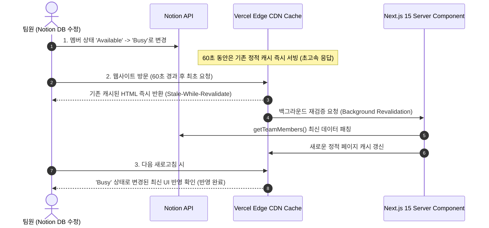

# 05. QA 검증 프로토콜 및 완료 기준 (Verification & Definition of Done)

본 문서는 에이전트가 개발 작업을 완료했다고 판단하기 전에 반드시 거쳐야 하는 엄격한 **품질 보증(QA) 프로토콜**과 **작업 완료 기준(Definition of Done, DoD)**을 정의합니다.

---

## 1. 완료 기준 (Definition of Done, DoD) 체크리스트

모든 코딩 태스크는 아래 7가지 항목을 100% 충족해야 배포 승인 상태가 됩니다:

- [ ] **Type Check 100%**: `npx tsc --noEmit` 실행 시 어떠한 타입 에러나 경고도 발생하지 않음 (`any` 타입 미사용).
- [ ] **Next.js 15 Build 0-Error**: `npm run build`가 정상 종료되고 `/` 라우트에 `revalidate: 60s`가 명시됨.
- [ ] **Tailwind v4 Invariant**: `tailwind.config.js`가 존재하지 않고, `app/globals.css`의 `@theme` 및 `@import "tailwindcss";`만으로 스타일링됨.
- [ ] **Graceful Degrade**: `.env.local`의 Notion 환경변수가 비어있거나 API가 4xx/5xx 에러를 반환해도 흰 화면(White Screen)이 뜨지 않고 정돈된 Empty State가 표시됨.
- [ ] **S3 URL Expiration Defense**: 이미지 URL이 손상되었거나 만료되어도 레이아웃이 깨지지 않고 다크 그래디언트 플레이스홀더로 Fallback됨.
- [ ] **WCAG 2.2 SC 2.4.7 Focus Invariant**: Tab 키로 모든 링크 및 버튼에 접근 시 선명한 2px 화이트 아웃라인 링이 렌더링됨.
- [ ] **Mobile & Desktop Responsive Invariant**: 모바일 375px부터 데스크톱 1920px까지 가로 스크롤(Horizontal Overflow) 없이 12-컬럼 비대칭 레이아웃이 유지됨.

---

## 2. 자동화 검증 명령어 (Automated Verification Suite)

에이전트는 코드 작성 후 다음 명령어를 순차 실행하여 결과를 자체 검증합니다:

```bash
# 1. TypeScript 엄격 타입 컴파일 검증
npx tsc --noEmit

# 2. ESLint 린트 검증
npm run lint

# 3. Next.js 15 프로덕션 빌드 검증
npm run build
```

빌드 출력 예시에서 메인 라우트가 ISR로 생성되었는지 확인합니다:
```text
Route (app)                              Size     First Load JS
┌ ○ /                                    5.2 kB         89.4 kB
└ ○ /_not-found                          875 B          85.1 kB
+ First Load JS shared by all            84.2 kB
  ├ chunks/23-149204.js                  52.1 kB
  └ other shared chunks (total)          32.1 kB

○  (Static)   prerendered as static content
●  (SSG)      prerendered as static HTML (uses getStaticProps)
ISR: 60s revalidation period applied to /
```

---

## 3. ISR 60초 캐시 갱신 실시간 검증 프로토콜

Notion DB 수정 사항이 배포 사이트에 60초 내로 정확히 반영되는지 검증하는 절차입니다:



### 검증 체크 단계:
1. 로컬 프로덕션 실행: `npm run build && npm run start`
2. Notion Team DB에서 특정 멤버의 `Status`를 `Available`에서 `Busy`로 변경.
3. 60초 대기 후 브라우저 새로고침.
4. 상태 뱃지가 주황색(`Busy`)으로 즉시 갱신되는지 확인.

---

## 4. Lighthouse 웹 바이탈 성능 기준

Vercel 또는 Cloudflare Pages 배포 후 Chrome DevTools Lighthouse 검사 시 다음 수치를 충족해야 합니다:

| 측정 지표 | 목표 기준 | 달성 전략 |
| :--- | :--- | :--- |
| **Performance** | **95점 이상** | RSC 데이터 사전 패칭, 가벼운 번들, ISR 정적 제공 |
| **Accessibility** | **100점** | WCAG 2.2 focus-visible, 시맨틱 태그(`main`, `header`, `section`), ARIA 라벨 |
| **Best Practices** | **100점** | HTTPS, Next.js Image 원격 최적화, 최신 웹 API 준수 |
| **SEO** | **100점** | 메타데이터(OpenGraph, Title, Description), 시맨틱 H1 태그 |
| **CLS (Cumulative Layout Shift)**| **0.00** | Bento Card 및 Image의 고정 비율 및 Aspect Ratio 사전 예약 |
| **LCP (Largest Contentful Paint)**| **< 1.2초** | 엣지 정적 캐싱 및 최적화된 SVG 아이콘 |
